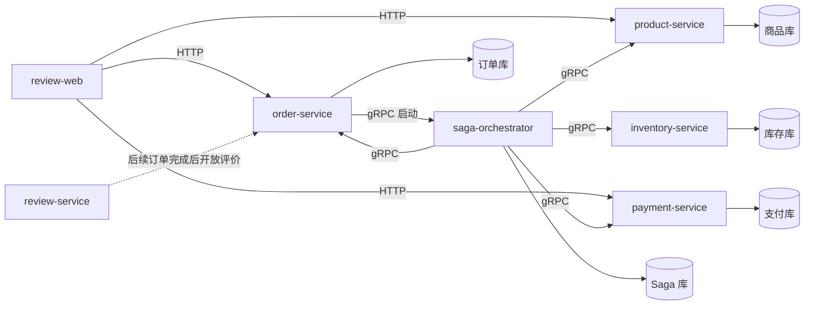

# 商品下单与支付 Saga 链路 PRD

| 项目 | 内容 |
|---|---|
| 状态 | 草案（供实现拆分与评审） |
| 版本 | 1.0 |
| 背景项目 | 现有评价系统：`review-web`、`review-service`、`review-B`、`review-O`、`review-job` |
| 方案 | 新增独立交易服务，采用持久化的编排式 Saga；现有评价链路保持兼容 |

## 1. 背景与问题

当前仓库包含消费者、商家、运营评价流程，但没有商品下单、库存占用和支付交易。为了学习分布式事务 Saga，需要增加一条跨服务交易链路，同时避免把现有评价服务重构成交易中心，也避免通过共享数据库事务掩盖服务之间的一致性问题。

本项目以可本地运行、可观察、可故障演示为优先目标。第一阶段使用模拟支付，不连接真实支付渠道；服务间使用现有 Kratos/gRPC 风格。Saga 编排器是独立可部署服务，负责持久化流程状态、调用参与服务、重试和发起补偿。

## 2. 目标与非目标

### 目标

1. 用户可以浏览商品、创建待支付订单、完成模拟支付并查询订单状态。
2. 交易跨商品、订单、库存、支付服务运行，失败时可以执行反向补偿。
3. Saga 状态持久化，编排器重启后能够恢复未完成流程。
4. 所有命令支持幂等；重复请求、重复回调和重试不产生重复扣库存或扣款。
5. 提供可注入的失败点和清楚的状态查询，便于演示成功、失败、超时、补偿和人工介入情形。
6. 新功能与现有评价系统隔离；不改变现有评价 API、数据表及其部署方式。

### 非目标（第一阶段）

- 接入真实银行卡、微信/支付宝等支付渠道。
- 多仓库、物流、优惠券、积分、拆单、部分退款、分布式库存、多商品复杂促销。
- 引入通用工作流引擎或事件协同式 Saga。
- 将现有评价服务迁移到新服务或重写现有登录鉴权。
- 将支付成功直接视为可评价；评价资格仍应在订单完成/确认收货后产生，后续单独集成。

## 3. 用户与核心场景

- **消费者**：查看商品，提交购买请求，模拟支付，查看订单及支付进度。
- **开发/学习者**：查看 Saga 当前步骤、失败原因、重试次数和补偿结果；通过配置触发指定步骤失败。
- **运维/演示者**：部署服务，查看健康状态、日志和流程状态，重启 Saga 编排器验证恢复。

### 核心用户故事

1. 消费者选择一个在售商品和数量，创建订单；服务返回订单号及待支付状态。
2. 用户提交模拟支付；支付成功后订单变为已支付。
3. 若商品失效、库存不足或支付失败，Saga 按已完成步骤逆序补偿，订单终止为失败或已取消。
4. 若支付成功但订单确认暂时失败，Saga 保持处理中并重试；不能错误释放库存或声称交易已回滚。
5. Saga 编排器重启后继续处理持久化的活动 Saga，不重复产生业务副作用。

## 4. 服务边界与部署单元

每个服务作为独立进程和 Kubernetes `Deployment + Service` 部署。服务拥有自己的数据表/数据库边界；任何服务不得直接读写其他服务的表。开发环境可使用 Docker Compose 和同一 MySQL 实例的独立 schema，以降低启动成本，但逻辑所有权仍隔离。

| 服务 | 职责与数据所有权 | 主要调用/接口 |
|---|---|---|
| 商品服务 `product-service` | 商品名、描述、当前售价、上架状态；商品查询与下单时商品校验 | HTTP 商品列表/详情；gRPC `GetProductForOrder` |
| 订单服务 `order-service` | 订单、订单明细、价格快照及订单状态 | HTTP 创建/查询订单；gRPC 创建、标记已支付、取消、查询 |
| 库存服务 `inventory-service` | 可用库存、库存预留及预留过期时间 | gRPC 预留、确认扣减、释放、查询 |
| 支付服务 `payment-service` | 支付单、支付状态、模拟支付结果 | HTTP 模拟支付/查支付单；gRPC 创建支付、确认、关闭、退款 |
| Saga 编排器 `saga-orchestrator` | Saga 实例、步骤、重试计划、补偿结果；不拥有商品/订单/库存/支付业务数据 | gRPC 启动 Saga、查询 Saga；内部调用参与服务 |
| 评价服务 `review-service` | 保持当前评价和申诉数据与接口 | 本期不加入支付调用；后续以订单完成事件/接口开放评价资格 |

服务间首期使用 gRPC 同步命令，Saga 状态通过编排器数据库持久化。HTTP 是 Web 前端入口，前端不得直接访问库存、订单或 Saga 数据库。服务注册沿用仓库现有 Consul/Kratos 方案；本地也允许配置直连地址，具体由实现配置决定。

### 部署拓扑



## 5. 订单支付主流程

### 5.1 创建待支付订单

```text
Web → 商品服务：获取商品和当前价格
Web → 订单服务：创建订单（商品 ID、数量、幂等键）
订单服务：校验请求并保存 PENDING_PAYMENT 订单和价格快照
订单服务 → Saga 编排器：StartOrderPayment(order_id)
Saga 编排器：创建 STARTED Saga 实例并持久化
Saga → 商品服务：重新校验商品在售与价格/版本
Saga → 库存服务：Reserve(order_id, product_id, quantity, reservation_id)
Saga → 支付服务：CreatePayment(order_id, amount, payment_idempotency_key)
Saga：持久化 WAITING_FOR_PAYMENT
订单服务 → Web：返回订单号和待支付状态
```

创建订单和启动 Saga 的可靠性必须处理“订单已写入但启动调用失败”。实现采用订单服务本地 outbox（与订单同库事务写入启动任务），后台投递给 Saga；或者采用可证明等价的可靠投递机制。单纯在订单写入后直接 RPC 而无恢复手段不满足验收。

### 5.2 模拟支付成功

```text
Web → 支付服务：提交模拟支付（payment_id、结果、幂等键）
支付服务：原子地把支付单置为 SUCCEEDED，并保存唯一支付结果
支付服务 → Saga：PaymentSucceeded(payment_id, order_id)（可靠重试）
Saga：校验当前状态及支付单关联，持久化回调/事件去重记录
Saga → 库存服务：ConfirmReservation(reservation_id)
Saga → 订单服务：MarkPaid(order_id, payment_id)
Saga：持久化 COMPLETED
Web：轮询订单/支付/Saga 查询接口，显示已支付
```

第一阶段可由支付服务同步调用 Saga 回调并重试；调用失败时支付仍保持成功，Saga 不得丢失该结果。推荐采用支付服务 outbox + 后台投递。所有参与操作均按业务幂等键去重。

### 5.3 失败和补偿

| 失败点 | 补偿策略 | 最终业务状态 |
|---|---|---|
| 商品校验失败 | 无已完成交易步骤；终止 Saga | 订单 `FAILED` 或 `CANCELLED` |
| 库存不足/预留失败 | 关闭待支付单（若已创建）；取消订单 | `FAILED` |
| 创建支付单失败 | 释放库存预留；取消订单 | `FAILED` |
| 支付明确失败 | 关闭支付单；释放预留；取消订单 | `FAILED` |
| 用户在支付期限内未支付 | 超时工作器启动取消 Saga：关闭支付单、释放预留、取消订单 | `CANCELLED` |
| 支付已成功，确认库存/订单暂时失败 | **不退款、不释放库存**；保留成功支付事实并持续重试确认 | `CONFIRMING`，成功后 `PAID`；超出策略转人工处理 |
| 已付款订单之后取消 | 另建退款流程：先申请退款，退款成功后释放库存并关闭订单；退款失败则保留待处理 | `REFUND_PENDING` / `REFUNDED` |

Saga 补偿只对已成功完成且可逆的步骤执行，按逆序执行。补偿失败时 Saga 进入 `COMPENSATION_REQUIRED`，持久化错误和重试信息并持续退避重试；禁止把补偿失败标成成功。支付成功后的后续失败属于正向重试/对账问题，不可将“退款”当作自动通用回滚。

## 6. 状态定义

### 订单状态

`PENDING_PAYMENT → PAID → COMPLETED`；未支付可转 `CANCELLED`，交易失败可转 `FAILED`。已支付取消进入退款流程，使用 `REFUND_PENDING → REFUNDED`；任何终态禁止被普通重试覆盖。首期可不实现 `COMPLETED` 的自动流转，但数据模型和评价资格不得将 `PAID` 等同 `COMPLETED`。

### 库存状态

`AVAILABLE → RESERVED → CONFIRMED`，或 `RESERVED → RELEASED/EXPIRED`。预留需绑定订单和唯一 reservation_id，设置过期时间；同订单同 reservation_id 重试返回一致结果。已确认的库存不能由“释放预留”操作恢复。

### 支付状态

`CREATED → SUCCEEDED | FAILED | CLOSED`；退款阶段为 `REFUND_PENDING → REFUNDED | REFUND_FAILED`。成功回调不可被迟到的失败回调覆盖；重复成功回调幂等。

### Saga 状态

`STARTED → VALIDATING_PRODUCT → RESERVING_STOCK → CREATING_PAYMENT → WAITING_FOR_PAYMENT → CONFIRMING_ORDER → COMPLETED`。失败分支进入 `COMPENSATING → FAILED/CANCELLED`；补偿持续失败进入 `COMPENSATION_REQUIRED`；成功支付后的确认故障进入 `CONFIRMING` 并重试。状态、当前步骤和步骤尝试记录必须可以持久化还原。

## 7. API 草案

所有 ID 使用字符串形式对外传输，金额使用整数最小货币单位（例如分），避免浮点误差。接口路径为建议值，评审后可随现有 Kratos 路由风格统一。

### Web HTTP

| 方法与路径 | 用途 |
|---|---|
| `GET /v1/products` | 商品列表（支持分页、上架过滤） |
| `GET /v1/products/{productID}` | 商品详情与当前售价 |
| `POST /v1/orders` | 创建待支付订单；Header `Idempotency-Key`；返回 `orderID`、金额、订单状态、支付状态 |
| `GET /v1/orders/{orderID}` | 查询订单、明细快照、状态 |
| `POST /v1/payments/{paymentID}/simulate` | 演示用支付结果：成功/失败；必须幂等，开发配置可关闭 |
| `GET /v1/payments/{paymentID}` | 查询支付单状态 |
| `GET /v1/sagas/{sagaID}` | 查询流程状态、当前步骤、尝试次数、补偿结果；面向开发/演示 |

### 服务间命令

- 商品：`GetProductForOrder(product_id)` → `product_id, name, price_minor, currency, active, version`。
- 库存：`ReserveStock(order_id, product_id, quantity, reservation_id, expires_at)`；`ConfirmReservation(reservation_id)`；`ReleaseReservation(reservation_id, reason)`。
- 支付：`CreatePayment(order_id, amount_minor, currency, idempotency_key)`；`ClosePayment(payment_id)`；`RefundPayment(payment_id, idempotency_key)`。
- 订单：`CreateOrder`；`MarkPaid(order_id, payment_id)`；`CancelOrder(order_id, reason)`；`GetOrder(order_id)`。
- Saga：`StartOrderPayment(order_id, request_id)`；`NotifyPaymentResult(payment_id, result, event_id)`；`GetSaga(saga_id/order_id)`。

所有服务间请求携带 `request_id`、`saga_id`、`order_id`（适用时）和调用来源，日志与 tracing 传播这些关联字段。外部接口按当前模拟登录方案允许显式消费者 ID，但须标注为开发演示，不代表生产鉴权。

## 8. 数据与一致性要求

- 商品表：商品 ID、名称、价格分、币种、上下架状态、版本、更新时间。
- 订单表/明细：唯一订单号、消费者 ID、金额分、币种、状态、幂等键；明细保存商品 ID/名称/单价/数量快照。
- 库存表/预留表：商品可用数量；预留 ID、订单 ID、商品 ID、数量、状态、到期时间；订单+商品/预留 ID 建唯一约束。
- 支付表：支付单号、订单 ID、金额、状态、请求幂等键、渠道流水（模拟渠道也生成）、支付/退款时间；订单可约束一笔有效支付。
- Saga 表：Saga ID、业务类型、订单 ID、状态、当前步骤、版本号、创建/更新时间、下次重试时间、最后错误；步骤表记录步骤、命令/结果摘要、状态、尝试次数、幂等键、时间戳。
- Outbox 表：事件 ID、聚合 ID、事件类型、负载、投递状态、尝试次数、下次投递时间。事件消费者保存 inbox/去重记录。
- 关键金额以整数最小货币单位存储；所有时间保存 UTC 或统一时间类型并在展示层转换。
- Saga 状态更新使用版本号/条件更新，避免多个回调和超时任务并发推进同一个 Saga。
- 每个命令可重放；至少一次投递由幂等消费实现有效一次业务效果。

## 9. 前端与用户体验

在现有 `review-web` 增加交易演示入口：商品列表/详情、下单确认、待支付页、支付模拟按钮、订单详情。页面展示订单金额、支付期限、订单/支付/Saga 状态和友好的失败原因；Saga 技术步骤可放在可展开的“流程追踪”区域，避免普通用户界面被实现细节淹没。

三种角色页面和现有评价页面保持原样。第一阶段消费者身份继续沿用当前 mock session；API 调用层新增交易服务地址。前端以轮询查询订单或 Saga（建议 1–2 秒间隔，最多 30 秒后提示仍在处理中），不把浏览器状态当作支付成功凭据。

## 10. 可靠性、失败注入与可观测性

- 默认超时：下单 Saga 事务时限及支付有效期均可配置；支付默认有效期建议 15 分钟，预留过期时间与之对齐并留少量清理余量。
- 仅对网络错误、超时和明确可重试服务错误进行指数退避重试，带最大间隔及随机抖动；业务拒绝（无库存、下架、金额变化）进入补偿/失败分支。
- 对处理中的预留和支付单提供后台过期扫描；扫描可重复运行且幂等。
- 失败注入仅在开发配置开启，可指定 `fail_at_step` 或模拟支付结果；生产配置不注册此能力。
- 提供健康检查、就绪检查、结构化日志、Prometheus 指标（如仓库已有指标规范则沿用）和 tracing。
- 日志字段至少包含 `trace_id`、`request_id`、`order_id`、`saga_id`、`payment_id`、`step`、`attempt`。
- 指标至少包括 Saga 成功/失败/处理中数量、各步骤耗时和重试数、补偿失败数、过期预留数、支付回调处理延迟。
- 查询 Saga 详情时不暴露支付敏感数据；支付模拟流水只包含演示所需状态与金额。

## 11. 安全与配置

- 模拟支付路由只允许在开发/演示 profile 启用；非开发配置应禁用或拒绝。
- 价格由商品服务确认，客户端提交的金额不可信；订单保存服务端价格快照。价格变化需返回明确错误并要求重新确认。
- 请求对消费者、订单归属做基本一致性校验。当前前端 mock 登录不能作为生产安全边界，PRD 验收范围不包含上线级认证。
- 配置从环境或配置文件读取服务地址、数据库、迁移开关、支付有效期、重试策略、失败注入开关；不得硬编码凭据。
- gRPC 采用 plaintext 仅限本地开发；生产部署使用集群网络策略及 TLS/服务认证（可作为后续加固项）。

## 12. 部署与运行

新增目录建议：`product-service/`、`order-service/`、`inventory-service/`、`payment-service/`、`saga-orchestrator/`。每个目录沿用现有 Kratos 项目的 `api/`、`cmd/`、`configs/`、`internal/{server,service,biz,data}/` 分层。为每项服务提供 Dockerfile、配置样例、数据库迁移和 K8s `Deployment`、`Service` 清单；可共享本地开发基础设施，但必须使用独立数据库 schema。新增 Helm/Kustomize 不作为第一阶段要求。

新增本地编排文件建议为 `docker-compose.saga.yml`，包含交易服务与所需 MySQL/Redis/Consul（若使用）；不要修改现有评价专用的 Kafka/Canal Compose 以承载交易流程。README 提供启动、初始化商品/库存、创建订单、成功支付、失败补偿、重启恢复的可复制步骤。

## 13. 验收标准

1. 本地可单独启动交易链路，不要求改动现有评价服务配置；现有评价页面与 API 回归可用。
2. 商品列表可见至少两种演示商品；创建订单后持久化价格快照，返回待支付订单及 Saga 标识。
3. 库存充足时能建立预留；库存不足时订单失败且没有残留预留/支付单。
4. 模拟支付成功后支付单为成功、预留为确认、订单为已支付、Saga 为完成；重复提交成功结果不会重复扣减库存或创建支付效果。
5. 模拟支付失败或创建支付失败后执行逆序补偿；库存恢复可售，订单进入明确终态，Saga 记录每一步和补偿结果。
6. 通过进程重启/短暂下游不可用验证 Saga 可恢复；重放 outbox 不会重复副作用。
7. 支付成功后订单服务短暂失败时不执行错误退款/释放；恢复后正向重试并完成，或进入明确的人工处理状态。
8. 到期未支付的订单最终关闭支付单、释放库存并取消订单；重复执行超时扫描安全。
9. 所有错误和状态可通过 API 与日志关联到同一个 `order_id`/`saga_id`，失败注入在生产模式不可用。
10. 关键单元/集成测试覆盖成功路径、每个补偿路径、幂等、重复回调、超时和恢复；迁移脚本可从空库构建所需表。

## 14. 分阶段交付建议

### 阶段 A：服务骨架与同步编排

建立五个交易服务、各自配置和数据边界；商品查询、创建订单、预留库存、创建支付单、Saga 持久化状态及服务间调用跑通。先提供模拟支付成功，不做前端完整体验。

### 阶段 B：支付结果、补偿与恢复

实现支付成功/失败通知、逆序补偿、幂等、outbox/inbox、重试退避、支付超时取消、进程恢复和失败注入。此阶段完成后再称 Saga 链路可用。

### 阶段 C：前端演示与部署

在 `review-web` 增加商品、下单、支付和订单状态页面；增加 Compose/Kubernetes manifests、启动文档、指标和端到端验收流程。

### 阶段 D：评价资格集成（后续）

订单从 `PAID` 进入 `COMPLETED` 后，由订单域提供可评价资格；评价服务校验订单归属和完成状态，避免仅凭客户端传入订单号发布评价。该阶段另开需求，不纳入本 PRD 的第一阶段交付。

## 15. 关键决策记录

1. 采用**编排式 Saga**：步骤和补偿由独立 Saga 编排器显式控制，便于学习流程和定位状态。
2. Saga 状态和步骤记录持久化；不以进程内状态或单次 RPC 调用作为流程记录。
3. 首期支付为模拟支付；支付成功后优先正向重试确认订单，不盲目自动补偿已发生的外部扣款。
4. 交易服务不共享业务表；评价服务本期只保留原能力。
5. 首期同步 gRPC 执行命令，可靠投递由本地 outbox/inbox 和持久化重试补足，不要求先建立 Kafka 交易总线。
